# Image-Based Cyber Attack Detection in UAV Using Telemetry Feature Transformation and Deep Learning


## Overview

This research explores an image-based deep learning approach for detecting cyber attacks in Unmanned Aerial Vehicle (UAV) networks.

The proposed approach transforms numerical UAV telemetry and network-related features into image representations, allowing computer vision-based deep learning architectures to identify patterns associated with malicious activities.

The framework is evaluated using two UAV cybersecurity datasets:

1. **UAV Attack Dataset** – Focuses on GPS-related attacks, including GPS spoofing and GPS jamming.
2. **UAVNIDS-2025** – Focuses on network-based attacks, including Blackhole, Wormhole, Sybil, and Flooding attacks.

Four deep learning architectures are evaluated: Custom CNN, EfficientNetB0, VGG16, and VGG19.

The objective is to investigate whether transforming structured telemetry and network features into image representations can provide an effective approach to UAV cyber attack detection.

---

## Research Objectives

- Investigate image-based feature representation for UAV cyber attack detection.
- Transform structured telemetry and network features into RGB images.
- Apply dimensionality reduction and class-balancing techniques.
- Evaluate different convolutional neural network architectures.
- Compare model performance across two UAV cybersecurity datasets.
- Analyse the effectiveness of image-based deep learning for detecting different categories of UAV attacks.

---

## Datasets

### 1. UAV Attack Dataset

The UAV Attack Dataset contains UAV telemetry data associated with normal operations and GPS-related cyber attacks.

**Attack categories:**
- Benign
- GPS Spoofing
- GPS Jamming

**Dataset source:**  
[IEEE DataPort – UAV Attack Dataset](https://doi.org/10.21227/00dg-0d12)

### 2. UAVNIDS-2025

UAVNIDS-2025 is used to evaluate the proposed approach against network-based attacks in UAV environments.

**Attack categories:**
- Normal
- Blackhole
- Wormhole
- Sybil
- Flooding

**Research paper:**  
[UAVIDS-2025: A Benchmark Dataset for Intrusion Detection in UAV Networks Using Machine Learning Techniques](https://ieeexplore.ieee.org/document/11194990/)

**Dataset DOI:**  
[10.21227/j5p4-zt27](https://doi.org/10.21227/j5p4-zt27)

> **Note:** The original datasets are not included in this GitHub repository. Users should obtain them from their respective sources and follow the preprocessing workflow.

---

## Proposed Methodology

The research follows a pipeline consisting of data preprocessing, dimensionality reduction, class balancing, image transformation, and deep learning-based classification.

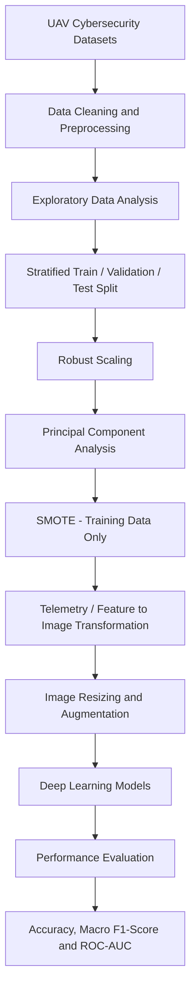

### 1. Data Preprocessing

The datasets are cleaned and prepared for subsequent analysis. This stage includes handling the input features and preparing the data for model training.

### 2. Exploratory Data Analysis

Exploratory analysis is performed to understand feature distributions, class imbalance, correlations, and relationships between features.

### 3. Data Splitting and Scaling

The data is divided into stratified training, validation, and testing subsets. RobustScaler is used for feature scaling.

### 4. Dimensionality Reduction

Principal Component Analysis (PCA) is applied to reduce the dimensionality of the feature space while retaining important information.

The number of PCA components used is:

| Dataset | PCA Components |
|---|---:|
| UAV Attack Dataset | 32 |
| UAVNIDS-2025 | 12 |

### 5. Class Balancing

SMOTE (Synthetic Minority Over-sampling Technique) is applied to the training data to address class imbalance.

The validation and test sets are kept separate from this oversampling process.

### 6. Feature-to-Image Transformation

The processed feature vectors are transformed into RGB image representations.

The generated images are normalized to the 0–255 pixel range and resized to **64 × 64 pixels** using nearest-neighbour interpolation.

Image augmentation techniques include:
- Horizontal and vertical flipping
- Rotation
- Colour jitter

### 7. Deep Learning Classification

The generated images are supplied to four deep learning architectures for classification.

---

## Dataset Visualizations

The following visualizations are generated during the UAVNIDS preprocessing and analysis stages.

### Class Distribution and Balancing

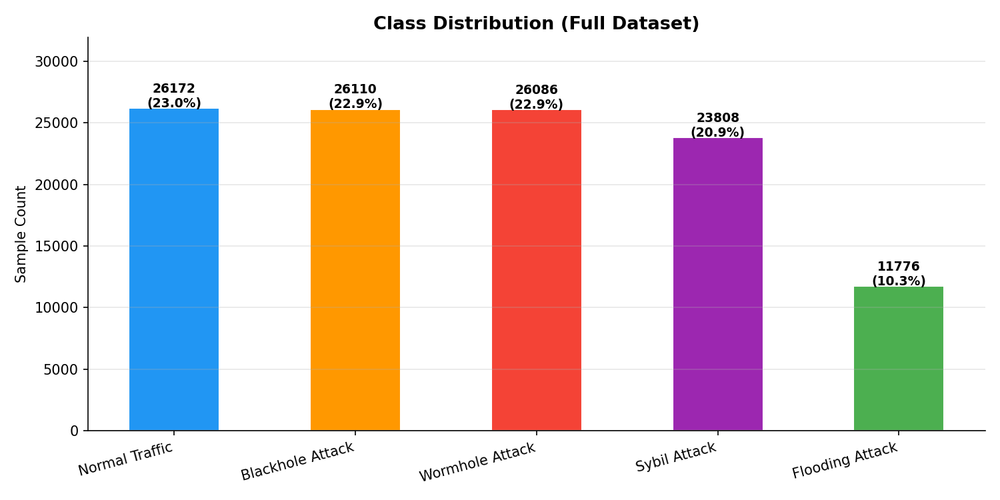

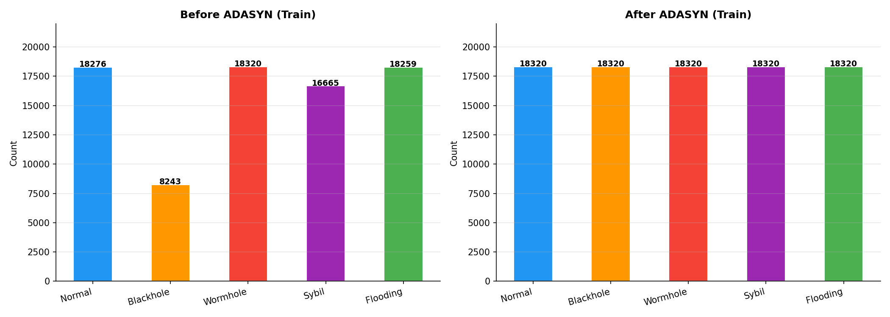


### Feature Analysis

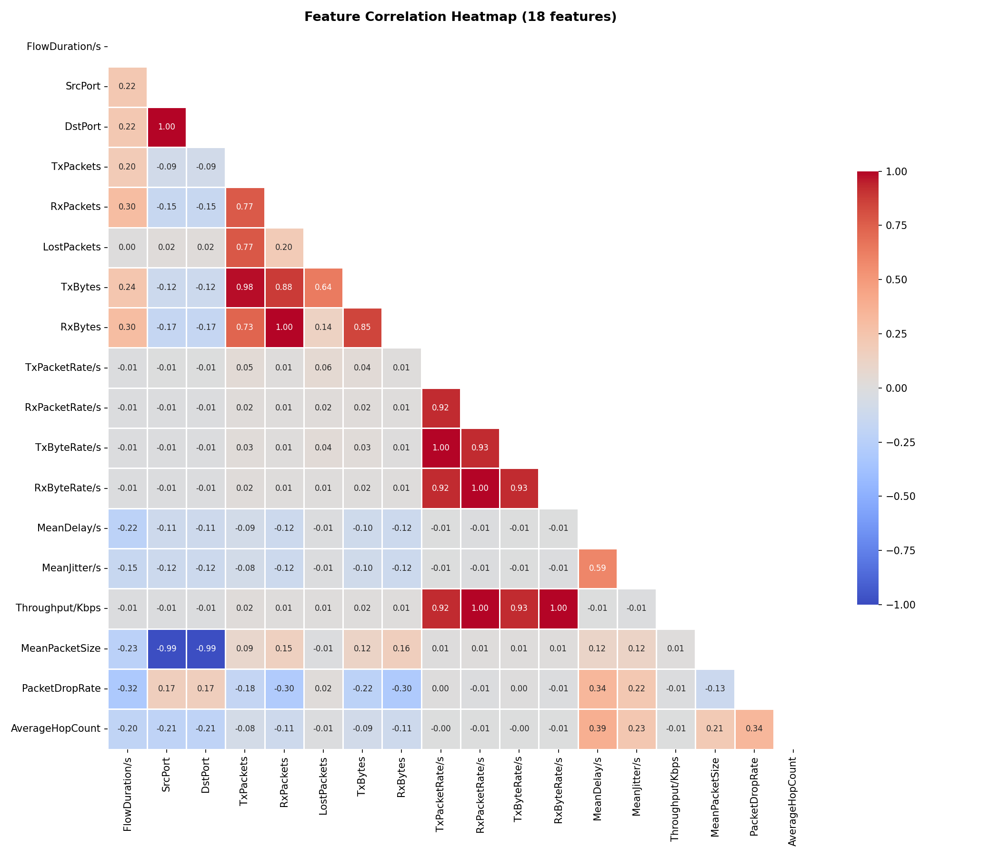

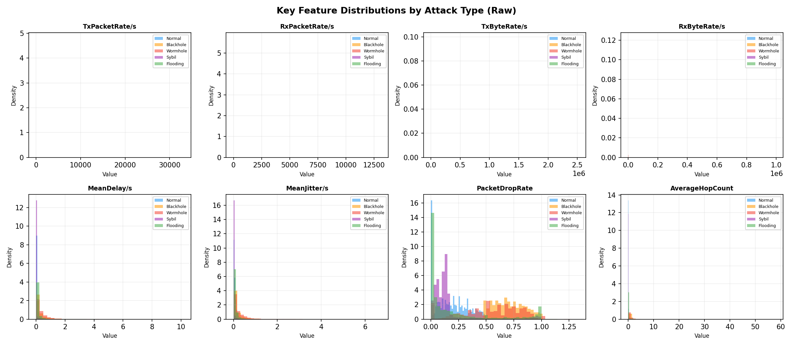

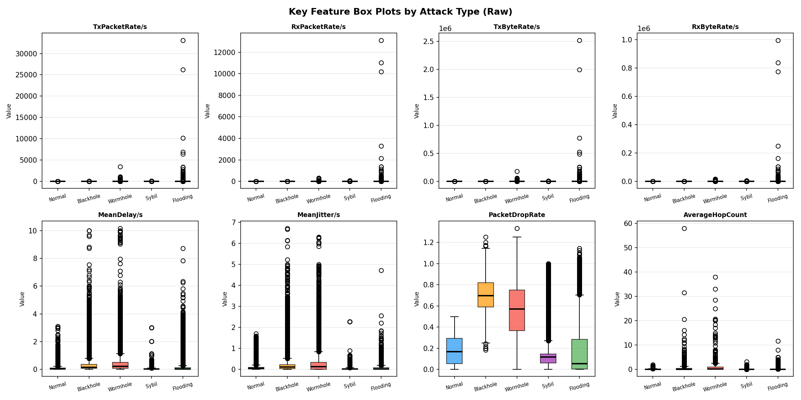

### PCA and Dimensionality Reduction

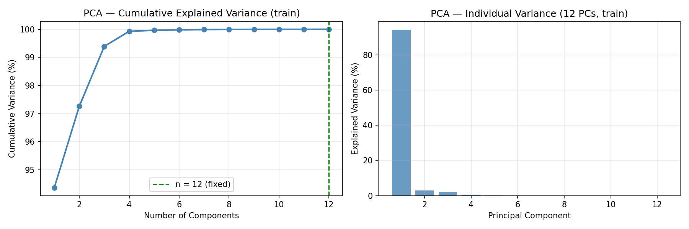

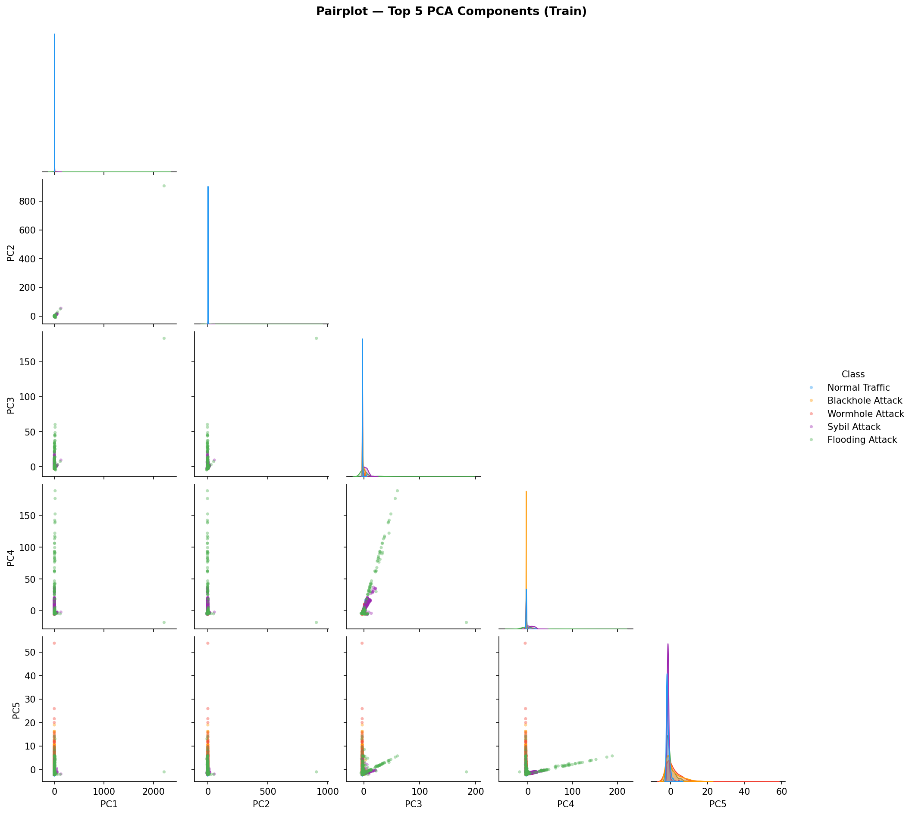

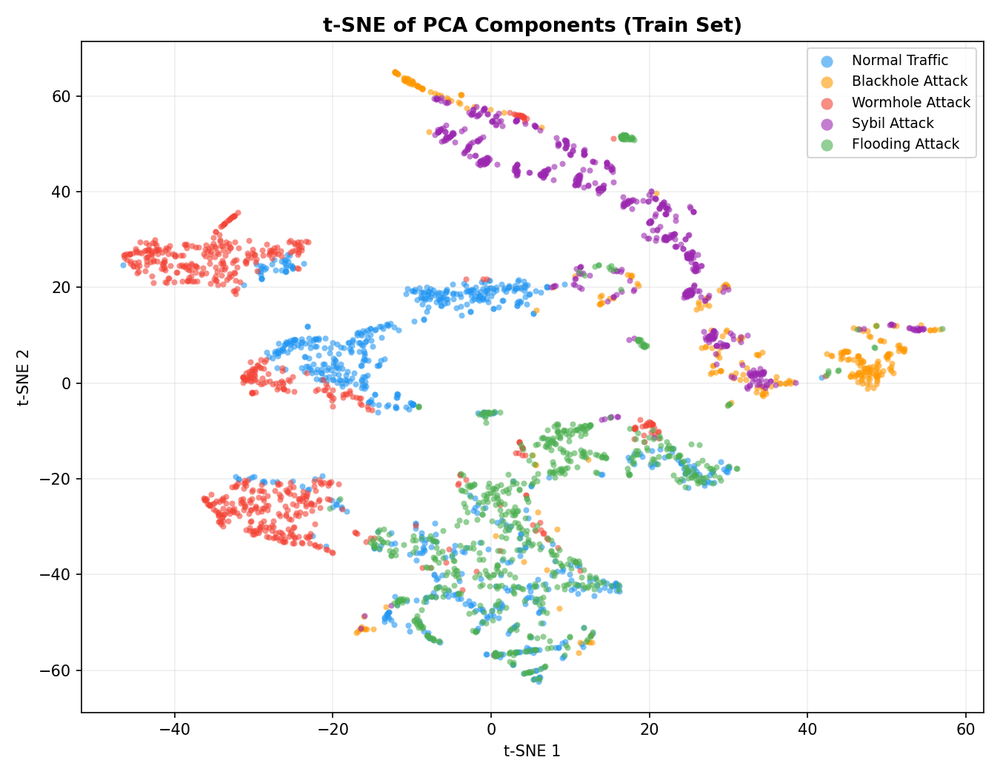

### Image Transformation

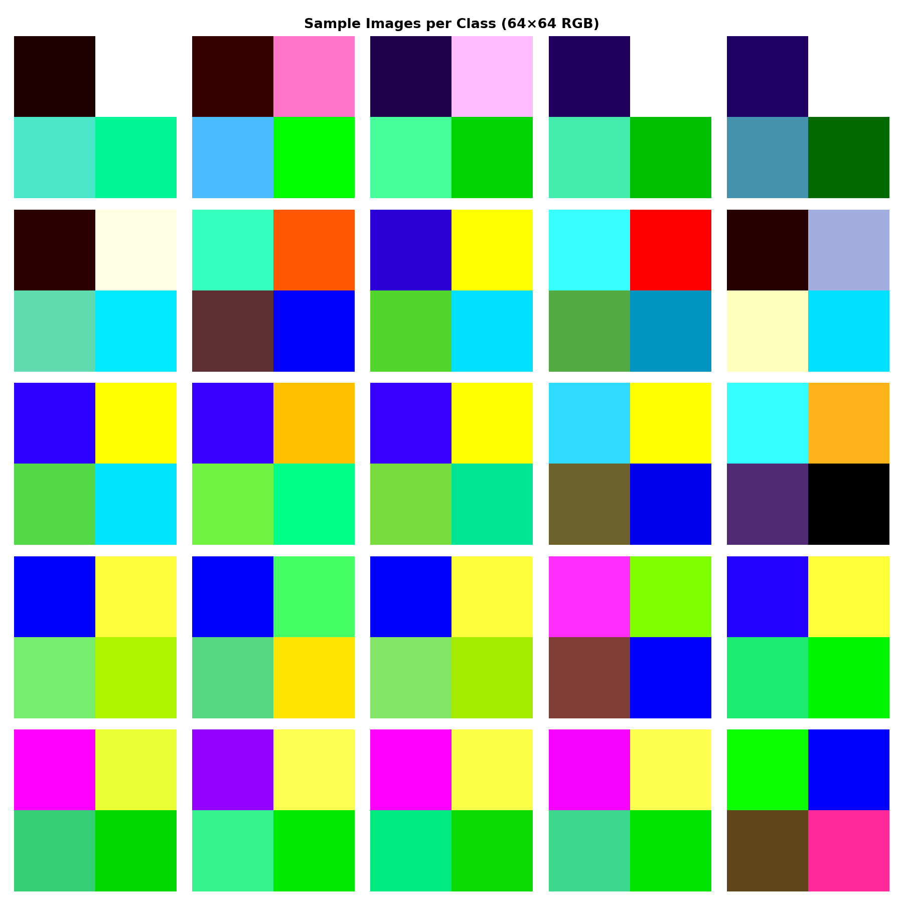

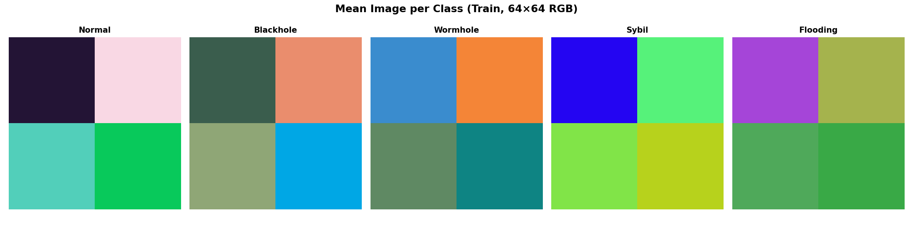

---

## Deep Learning Architectures

Four architectures are implemented and evaluated.

| Architecture | Description |
|---|---|
| Custom CNN | A custom convolutional neural network designed for image-based classification. |
| EfficientNetB0 | A lightweight convolutional architecture using compound scaling. |
| VGG16 | A deep convolutional neural network with 16 weight layers. |
| VGG19 | A deeper VGG architecture with 19 weight layers. |

### Training Configuration

The training pipeline uses the following configuration:

| Parameter | Configuration |
|---|---|
| Optimizer | AdamW |
| Learning Rate | 0.0001 |
| Learning Rate Scheduler | Cosine Annealing |
| Early Stopping | Enabled |
| Image Size | 64 × 64 |
| Image Channels | RGB |
| Class Balancing | SMOTE |
| Feature Scaling | RobustScaler |
| Dimensionality Reduction | PCA |

---

## Experimental Results

The models are evaluated using three performance metrics:

- **Accuracy:** Measures the proportion of correctly classified samples.
- **Macro F1-Score:** Calculates the F1-score independently for each class and averages the results.
- **ROC-AUC:** Evaluates the model's ability to distinguish between classes.

### UAV Attack Dataset

| Model | Accuracy | Macro F1-Score | ROC-AUC |
|---|---:|---:|---:|
| Custom CNN | **99.87%** | **99.82%** | **100.00%** |
| EfficientNetB0 | 95.43% | 93.77% | 99.50% |
| VGG16 | 99.60% | 98.82% | 99.99% |
| VGG19 | 99.80% | 99.73% | **100.00%** |

### UAVNIDS-2025

| Model | Accuracy | Macro F1-Score | ROC-AUC |
|---|---:|---:|---:|
| Custom CNN | 88.49% | 88.70% | 98.70% |
| EfficientNetB0 | 88.82% | 89.13% | 98.71% |
| VGG16 | 89.72% | 90.14% | 98.87% |
| VGG19 | **90.61%** | **91.02%** | **99.05%** |

### Key Observations

- Custom CNN achieved the highest accuracy on the UAV Attack Dataset.
- VGG19 achieved the highest accuracy and Macro F1-score on UAVNIDS-2025.
- The results demonstrate differences in model performance across telemetry-based and network-based attack datasets.
- ROC-AUC scores were consistently high across the evaluated architectures.

---

## Repository Structure

```text
Image-Based-Cyber-Attack-Detection-in-UAV/
│
├── UAVATTACK/
│   ├── preprocessing.py
│   ├── model_output/
│   ├── model_output_vgg/
│   └── ...
│
├── UAVNIDS/
│   ├── preprocessing.py
│   ├── preprocessed_output/
│   │   ├── images/
│   │   ├── plots/
│   │   └── meta.json
│   ├── model_output/
│   ├── model_output1/
│   ├── model_output_vgg/
│   └── ...
│
├── README.md
└── LICENSE
```

The repository contains preprocessing scripts, generated image representations, analysis visualizations, and selected trained model checkpoints.

---

## Trained Model Weights

The repository contains selected trained model checkpoints. Due to GitHub's file-size limitations, the larger VGG16 and VGG19 checkpoints are hosted separately on Google Drive.

**[Download VGG16 and VGG19 Model Weights – Google Drive](https://drive.google.com/drive/folders/1MbE8Pgh25TKrDATtm09pib-R5MJuqmTx?usp=sharing)**

The following checkpoints are available through Google Drive:

| Dataset | Architecture | Checkpoint |
|---|---|---|
| UAVATTACK | VGG16 | `VGG16_best.pth` |
| UAVATTACK | VGG19 | `VGG19_best.pth` |
| UAVNIDS | VGG16 | `VGG16_best.pth` |
| UAVNIDS | VGG19 | `VGG19_best.pth` |

Other selected checkpoints, including CustomCNN and EfficientNetB0 weights, are retained in the repository.

---

## Technologies and Libraries

The project uses Python and machine learning/deep learning libraries for data processing, image transformation, model training, and evaluation.

- Python
- PyTorch
- NumPy
- Pandas
- Scikit-learn
- Imbalanced-learn
- Matplotlib
- Seaborn
- Pillow

---

## Reproducibility

To reproduce the experiments:

1. Clone this repository.
2. Download the corresponding original datasets from their official sources.
3. Place the datasets in the appropriate project directories.
4. Install the required Python libraries.
5. Execute the preprocessing workflow.
6. Generate the image representations.
7. Train or evaluate the deep learning architectures using the available scripts and model checkpoints.

**Clone the repository:**

```bash
git clone https://github.com/HanumatNegi/Image-Based-Cyber-Attack-Detection-in-UAV-Using-Telemetry-Feature-Transformation-and-Deep-learning.git

cd Image-Based-Cyber-Attack-Detection-in-UAV-Using-Telemetry-Feature-Transformation-and-Deep-learning
```

Install the core dependencies:

```bash
pip install numpy pandas scikit-learn imbalanced-learn matplotlib seaborn pillow torch torchvision
```

Additional dependencies may be required depending on the specific scripts and execution environment.

---

## Future Scope

Potential directions for extending this research include:

- Evaluating the framework on additional UAV and FANET cybersecurity datasets.
- Investigating more advanced feature-to-image transformation techniques.
- Exploring lightweight deep learning architectures for resource-constrained UAV platforms.
- Improving generalization across different UAV environments and attack scenarios.
- Investigating real-time UAV intrusion detection and deployment.

---

## Acknowledgements

This research makes use of publicly available UAV cybersecurity datasets and builds upon existing work in UAV intrusion detection, feature engineering, and deep learning.

The original dataset authors and research communities are acknowledged for making their datasets and research resources available.

---

## Author

**Hanumat Singh Negi**

B.Sc. (Hons.) Computer Science  
Doon University, Dehradun, India

**Research Area:** UAV Cybersecurity, Intrusion Detection Systems, Deep Learning, and Image-Based Feature Representation.

---

## License

This project is distributed under the license specified in the repository's `LICENSE` file.

If you use this work, please cite the relevant dataset publications and acknowledge this repository.

**GitHub Repository:**  
[Image-Based Cyber Attack Detection in UAV Using Telemetry Feature Transformation and Deep Learning](https://github.com/HanumatNegi/Image-Based-Cyber-Attack-Detection-in-UAV-Using-Telemetry-Feature-Transformation-and-Deep-learning)


**NOTE**
AI agent Claude was used for for resolving errors during the execution of code
